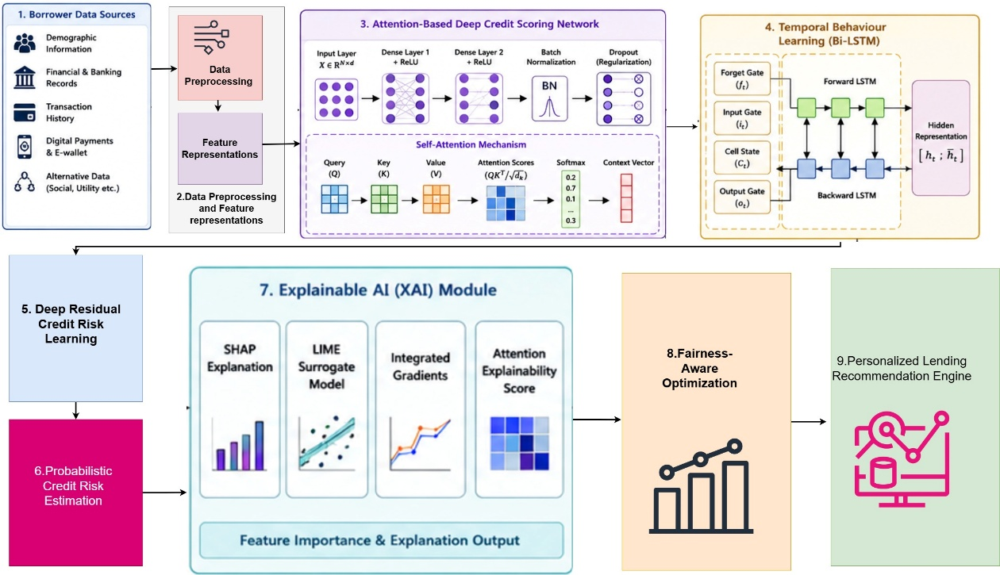
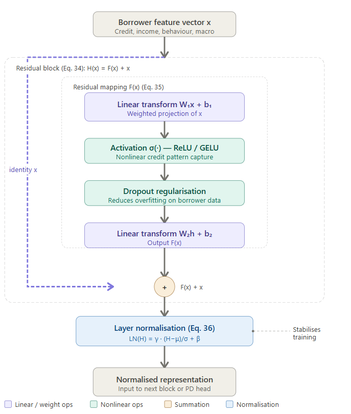
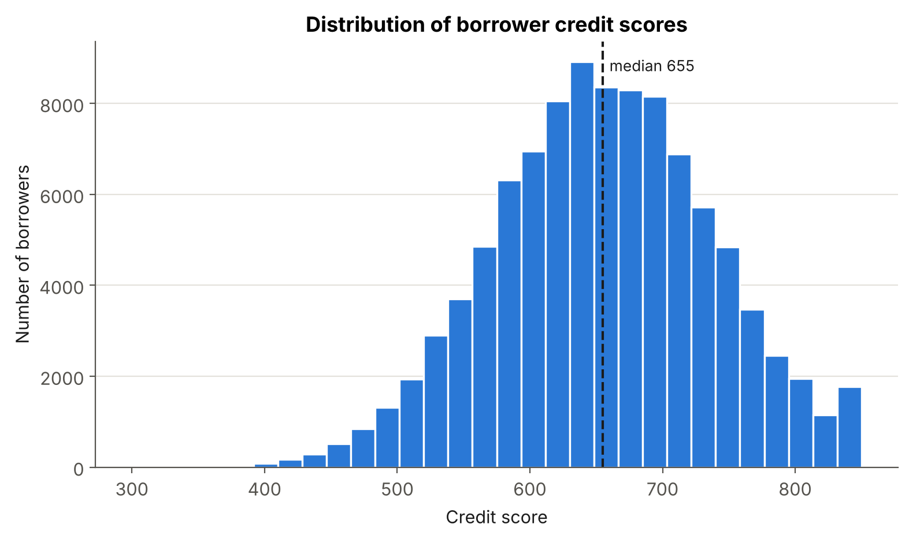
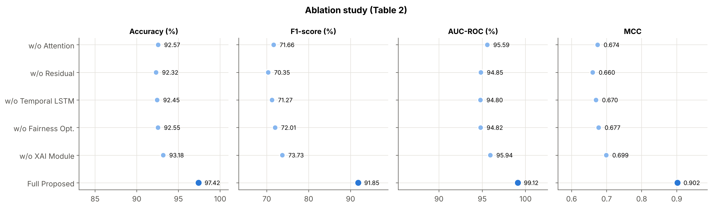
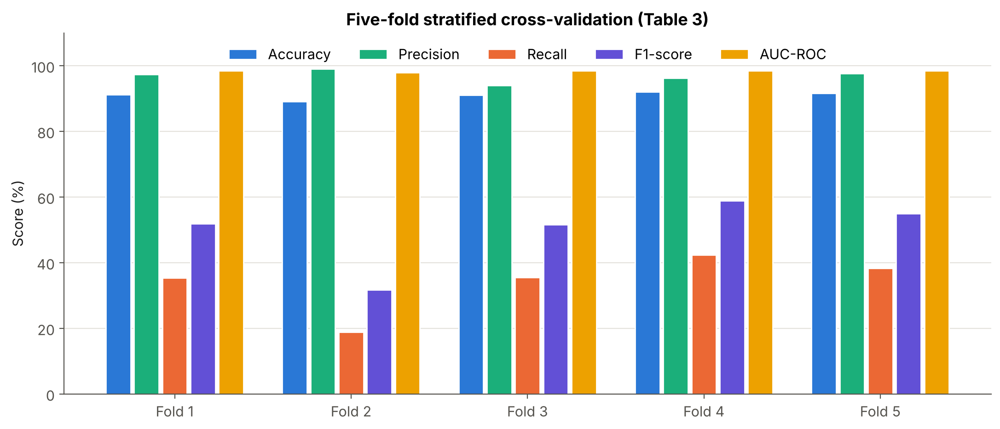
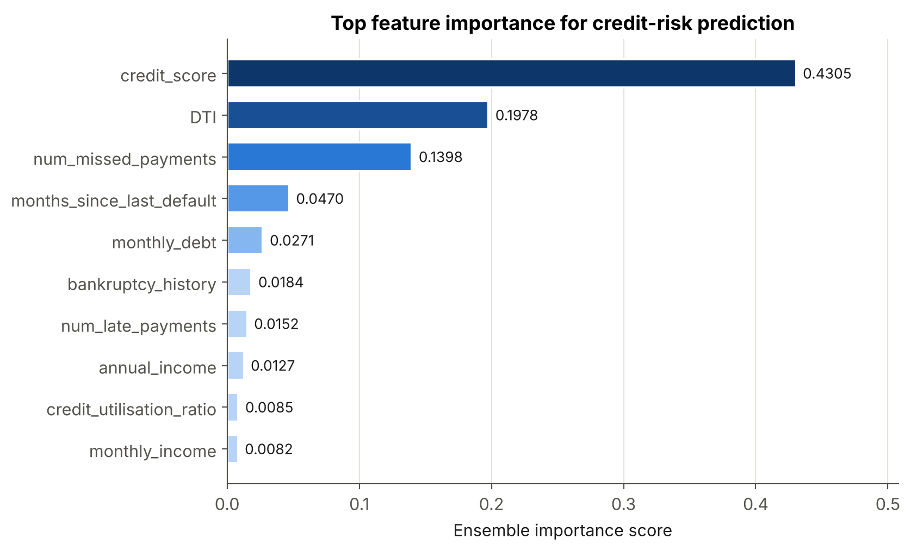
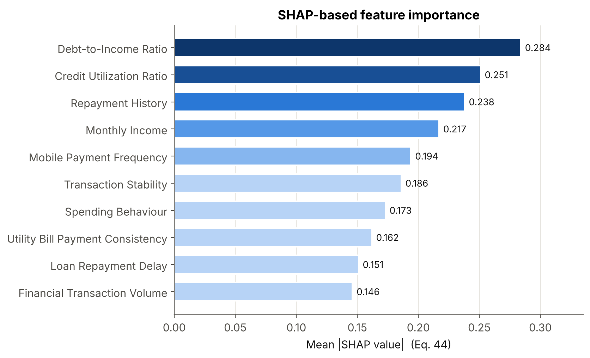
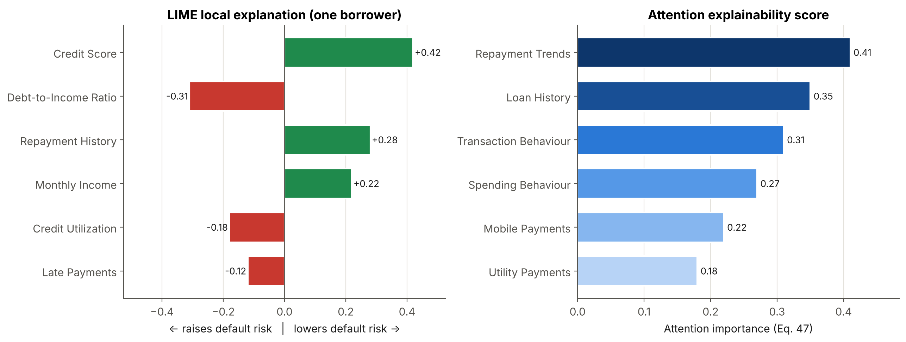
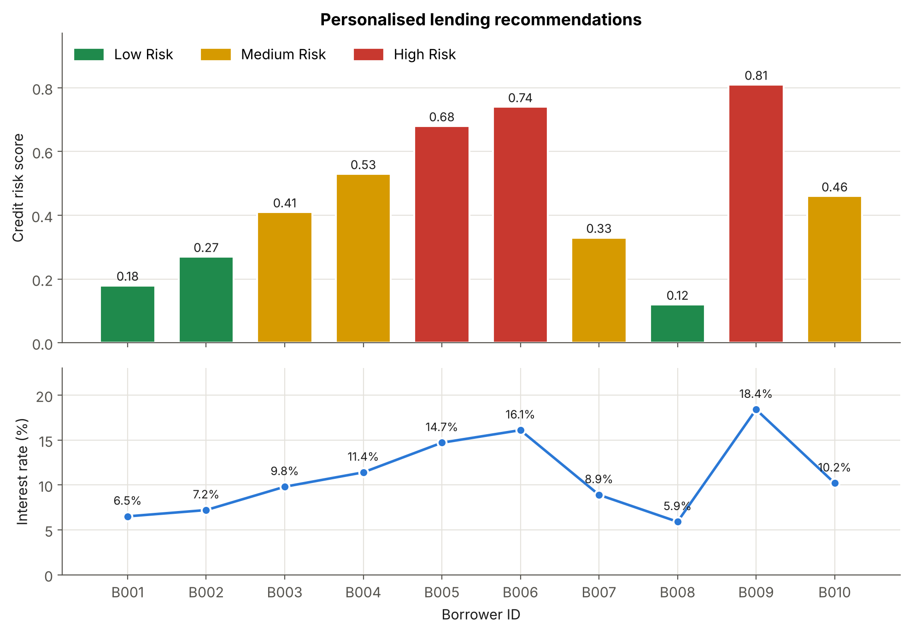
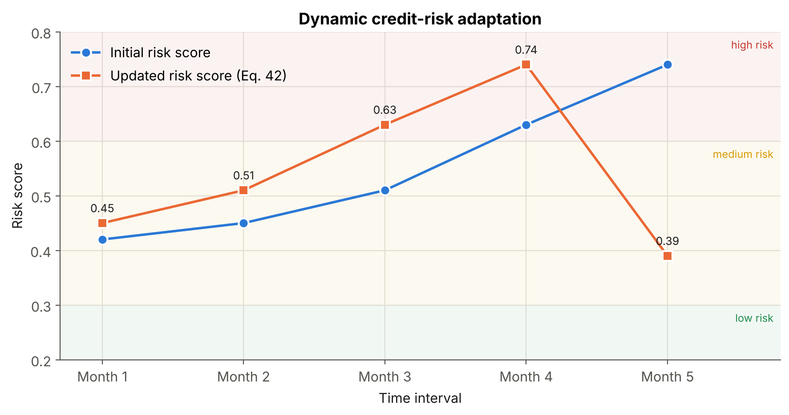

# Explainable FinTech Models for Credit Scoring, Personalized Lending, and Trustworthy Financial Decision-Making

Official-style implementation of the Explainable FinTech framework: an **attention-based deep credit-scoring
network** with **Bi-LSTM temporal behaviour learning**, **residual credit-risk learning**, **probabilistic
(Bayesian MC-dropout) risk estimation**, **fairness-aware optimisation**, a full **XAI module**
(SHAP · LIME · Integrated Gradients · attention scores), and a **personalised lending engine** with dynamic
risk adaptation.

  

| Metric (test set, paper) | Accuracy | F1-score | AUC-ROC | MCC |
|---|---|---|---|---|
| **Full proposed framework** | **97.42 %** | **91.85 %** | **99.12 %** | **0.9024** |

---

## Contents
1. [Framework overview](#1-framework-overview)
2. [Equation → code map](#2-equation--code-map)
3. [Repository structure](#3-repository-structure)
4. [Installation](#4-installation)
5. [Data](#5-data)
6. [Quick start & reproducing the paper](#6-quick-start--reproducing-the-paper)
7. [Results and figures](#7-results-and-figures)
8. [Using the components in your own code](#8-using-the-components-in-your-own-code)
9. [Citation](#9-citation)
10. [References](#10-references)

---

## 1. Framework overview



**Figure 1.** Overall Explainable FinTech framework for credit scoring, personalised lending and trustworthy
financial decision-making.

The network (`src/xfintech/model.py`) has two branches that are fused before the residual head:

```
x ∈ R^d ─► Dense(128)+ReLU ─► Dense(64)+ReLU ─► BatchNorm ─► Dropout ─────────────────────┐  Eq. 13–18
 │                                                                                         │
 └─► FeatureTokenizer e_j = x_j W_j + b_j ─► 8-head self-attention ─► Add & LayerNorm      │  Eq. 10, 19–24
       ─► Bi-LSTM (64 ⟷ 64) ─► attention pooling  α = softmax(e),  c = Σ α_i h_i ──────────┤  Eq. 27–33, 25–26
                                                                                           ▼
                                   Concat ─► Dense(128) ─► Residual block × 2 ─► Dropout      Eq. 34–36
                                                                                           ▼
                                            z = Wᵀh + b ─► σ(z) = P(default | x)              Eq. 37–38
```



**Figure 2.** Deep residual credit-risk learning block: `H(x) = LN(x + F(x))`, `F(x) = W₂ σ(W₁x + b₁) + b₂`.

Training minimises the fairness-aware objective

```
L_fair = L_BCE(y, ŷ) + λ · | P(ŷ | A = 1) − P(ŷ | A = 0) |      (Eq. 50–51, 59)
```

with Adam (Eq. 61–65), early stopping and reduce-on-plateau learning-rate scheduling. Optional adversarial
debiasing (Eq. 52) is available through a gradient-reversal adversary (`fairness.adversarial: true`).

## 2. Equation → code map

| Paper section | Equations | Implementation |
|---|---|---|
| 3.1 Problem formulation | 1–6 | `pipeline.prepare_splits`, `train.Trainer` |
| 3.2 Pre-processing | 7 (z-score), 8 (mean imputation), 9 (one-hot), 10 (embedding), 11 (concat) | `preprocessing.TabularPreprocessor`, `model.FeatureTokenizer` |
| 3.3 Deep credit-scoring network | 12–18 | `model.build_model` (dense / BN / dropout) |
| 3.4 Self-attention | 19–26 | `layers.MultiHeadAttention`, `model.AttentionPooling` |
| 3.5 Temporal Bi-LSTM | 27–33 | `layers.Bidirectional(LSTM)` |
| 3.6 Residual learning | 34–36 | `model.ResidualBlock` |
| 3.7 Probabilistic risk | 37–40 | sigmoid head; `uncertainty.mc_dropout_predict` (Eq. 40) |
| 3.7 Risk score & adaptation | 41–42 | `lending.linear_credit_risk_score`, `lending.dynamic_risk_update` |
| 3.8 XAI | 43–47 | `explain.shap_values`, `global_importance`, `lime_explanation`, `integrated_gradients`, `attention_scores` |
| 3.9 Fairness | 48–52 | `fairness.*` (metrics, `bias_regularizer`, `gradient_reversal`) |
| 3.10 Lending engine | 53–58 | `lending.LendingEngine`, `debt_to_income`, `credit_utilisation`, `behaviour_evolution` |
| 3.11 Optimisation | 59–65 | `train.weighted_bce`, `train.Trainer` (Adam) |

## 3. Repository structure

```
explainable-fintech-credit-scoring/
├── configs/default.yaml          # hyper-parameters from Section 4.3
├── data/                         # dataset goes here (see data/README.md); 2k-row synthetic sample bundled
├── docs/paper_figures/           # Figures 1–2 (framework & residual block diagrams)
├── figures/                      # Figures 3–8 + Table 2/3 charts (generated by scripts/make_figures.py)
├── results/paper_results.json    # numbers reported in the paper (drives the figures below)
├── scripts/
│   ├── download_data.py          # fetch the FinTech Credit Risk Dataset
│   ├── generate_synthetic_data.py
│   ├── train.py                  # train + test metrics + fairness report
│   ├── explain.py                # SHAP, LIME, IG, attention, permutation, ensemble importance
│   ├── lending_demo.py           # personalised lending table + dynamic risk trajectory
│   ├── run_ablation.py           # Table 2
│   ├── run_cv.py                 # Table 3
│   └── make_figures.py           # every figure from a results JSON
├── src/xfintech/                 # the library (data, preprocessing, model, train, fairness, explain, lending, plots)
├── tests/                        # unit tests (pytest)
├── run_all.sh                    # end-to-end reproduction
└── requirements.txt
```

## 4. Installation

```bash
git clone https://github.com/<your-username>/explainable-fintech-credit-scoring.git
cd explainable-fintech-credit-scoring
python -m venv .venv && source .venv/bin/activate      # Windows: .venv\Scripts\activate
pip install -r requirements.txt
pytest -q tests                                        # sanity check
```

The paper's experiments used an Intel Core i9, 128 GB RAM and an NVIDIA RTX GPU. A GPU is recommended for the
full 300 k-row dataset; CPU is fine for the sample data.

## 5. Data

The experiments use the **FinTech Credit Risk Dataset** [30]: ~300 000 borrowers, 51 demographic, financial,
behavioural and alternative-data attributes (age, gender, education, employment type, income, debt, spending,
credit utilisation, repayment trend, mobile-money usage, transaction behaviour, …), with ~86.29 % non-default and
~13.71 % default borrowers. Data is split 70 / 15 / 15 (train / validation / test), stratified on the label.

```bash
python scripts/download_data.py                 # or download manually — see data/README.md
```

No data file? `scripts/train.py` creates a **synthetic dataset with the same schema** so the full pipeline runs
out of the box (`python scripts/generate_synthetic_data.py --n 300000` creates it explicitly). Synthetic results are
for testing the code only and are not the paper's results.

## 6. Quick start & reproducing the paper

```bash
# 2-epoch smoke test on the bundled sample (≈1 min on CPU)
python scripts/train.py --set data.path=data/sample_synthetic.csv --set training.epochs=2 --set output_dir=runs/smoke

# full reproduction (all tables and figures) on the real dataset
bash run_all.sh
```

| Paper artefact | Command | Output |
|---|---|---|
| Test metrics + fairness | `python scripts/train.py` | `runs/default/results.json` |
| Figures 4, 5, 6 | `python scripts/explain.py --run runs/default` | `feature_importance`, `shap_importance`, `lime_local`, `attention_importance` |
| Figures 7, 8 | `python scripts/lending_demo.py --run runs/default` | `lending`, `dynamic_risk`, `lending_recommendations.csv` |
| Table 2 (ablation) | `python scripts/run_ablation.py` | `ablation` |
| Table 3 (5-fold CV) | `python scripts/run_cv.py --subset 20000` | `cross_validation` |
| All figures | `python scripts/make_figures.py --results runs/default/results.json --out runs/default/figures` | PNGs |

Any config value can be overridden from the command line, e.g. `--set model.dropout=0.4 --set fairness.lambda_bias=1.0`.

**Main hyper-parameters (Section 4.3):** Adam, learning rate 0.001, batch size 128, up to 100 epochs with early
stopping and LR scheduling; dense layers 128 → 64 (ReLU); Bi-LSTM 64 units per direction; 8 attention heads
(scaled dot-product); dropout searched in [0.2, 0.5] (default 0.3); fairness weight λ = 0.5.

## 7. Results and figures

> The charts below are drawn by `scripts/make_figures.py` from the values reported in the paper
> (`results/paper_results.json`). Running the pipeline writes the same keys to `runs/<name>/results.json`, so the
> identical command regenerates every figure from your own run.

### 7.1 Dataset — credit-score distribution



**Figure 3.** Distribution of borrower credit scores. Most borrowers sit between 550 and 750; scores below 500 are
rare and high-risk. *(Drawn from the synthetic schema-compatible data in this repository; point `--data` at the real
file to redraw it.)*

### 7.2 Ablation study (Table 2)

| Configuration | Accuracy (%) | F1-score (%) | AUC-ROC (%) | MCC |
|---|---|---|---|---|
| w/o Attention | 92.57 | 71.66 | 95.59 | 0.6744 |
| w/o Residual | 92.32 | 70.35 | 94.85 | 0.6604 |
| w/o Temporal LSTM | 92.45 | 71.27 | 94.80 | 0.6698 |
| w/o Fairness Opt. | 92.55 | 72.01 | 94.82 | 0.6773 |
| w/o XAI Module | 93.18 | 73.73 | 95.94 | 0.6991 |
| **Full Proposed** | **97.42** | **91.85** | **99.12** | **0.9024** |



Removing the residual block causes the largest single-component drop in F1 (70.35 % vs. 91.85 %), and removing
the temporal Bi-LSTM lowers AUC-ROC to 94.80 %. The XAI module is post-hoc and does not change the forward pass, so
in `run_ablation.py` that row retrains the full model with a different seed.

### 7.3 Five-fold stratified cross-validation (Table 3)

| Fold | Accuracy | Precision | Recall | F1-score | AUC-ROC |
|---|---|---|---|---|---|
| 1 | 91.22 | 97.42 | 35.33 | 51.85 | 98.51 |
| 2 | 89.12 | 99.02 | 18.88 | 31.71 | 97.97 |
| 3 | 91.07 | 94.06 | 35.51 | 51.56 | 98.44 |
| 4 | 92.05 | 96.19 | 42.35 | 58.81 | 98.51 |
| 5 | 91.60 | 97.62 | 38.25 | 54.96 | 98.42 |
| **Mean ± SD** | **91.01 ± 1.12** | **96.86 ± 1.86** | **34.06 ± 8.95** | **49.78 ± 10.52** | **98.37 ± 0.23** |



AUC-ROC is stable across folds (SD 0.23); recall and F1 vary more because of minority-class variance between folds
at the fixed 0.5 threshold.

### 7.4 Feature importance and explainability



**Figure 4.** Ensemble feature importance. Credit score (0.4305), debt-to-income ratio (0.1978) and number of missed
payments (0.1398) dominate. In this code the ensemble is the mean of normalised SHAP, integrated-gradient,
attention and permutation importances (`explain.ensemble_importance`).



**Figure 5.** SHAP global importance `FI_j = mean |φ_ij|` (Eq. 44). SHAP values of one-hot columns are summed per
original attribute before averaging.



**Figure 6.** Left: LIME local explanation for a single borrower (Eq. 45); green features support repayment, red
features raise default risk. Right: attention explainability scores (Eq. 47) aggregated into behavioural groups
(`xai.attention_groups` in the config).

### 7.5 Personalised lending and dynamic risk adaptation



**Figure 7.** Credit-risk score by borrower and band (top) and the resulting adaptive interest rate
`R_i = R_b + α · CRS_i` (Eq. 55, bottom). Loans are approved when `CRS_i < τ` (Eq. 56). The two measures are shown
in aligned panels rather than on a dual axis.



**Figure 8.** Dynamic credit-risk adaptation over five months: `CRS_t = λ · CRS_{t−1} + (1 − λ) · f(x_t)` (Eq. 42).
The score climbs from medium to high risk in months 3–4 and drops to 0.39 after the borrower's behaviour recovers
in month 5.

## 8. Using the components in your own code

```python
import sys; sys.path.insert(0, "src")
from xfintech.config import load_config
from xfintech.pipeline import get_dataframe, prepare_splits, run_experiment
from xfintech.explain import integrated_gradients, attention_scores, global_importance
from xfintech.lending import LendingEngine
from xfintech.uncertainty import mc_dropout_predict

cfg = load_config("configs/default.yaml")
splits = prepare_splits(get_dataframe(cfg), cfg)
res = run_experiment(cfg, splits)                      # trains with fairness regularisation
model, pre = res["model"], splits["pre"]

ig = integrated_gradients(model, splits["X_test"][:200])                 # Eq. 46
print(global_importance(ig, pre.feature_groups_).head())
print(attention_scores(model, splits["X_test"][:200], pre.feature_groups_).head())   # Eq. 47

mc = mc_dropout_predict(model, splits["X_test"][:10])                    # Eq. 40: mean ± std PD
print(LendingEngine.from_config(cfg["lending"]).recommend(range(10), mc["mean"]))
```

## 9. Citation

```bibtex
@article{explainable_fintech_2026,
  title   = {Explainable FinTech Models for Credit Scoring, Personalized Lending,
             and Trustworthy Financial Decision-Making},
  author  = {<Author names>},
  journal = {<Journal>},
  year    = {2026}
}
```

## 10. References

**Methods implemented in this repository**

1. Lundberg, S. M., & Lee, S.-I. (2017). A unified approach to interpreting model predictions. *Advances in Neural Information Processing Systems 30* (NeurIPS).
2. Ribeiro, M. T., Singh, S., & Guestrin, C. (2016). "Why should I trust you?": Explaining the predictions of any classifier. *Proceedings of the 22nd ACM SIGKDD*, 1135–1144.
3. Sundararajan, M., Taly, A., & Yan, Q. (2017). Axiomatic attribution for deep networks. *Proceedings of the 34th ICML*, PMLR 70, 3319–3328.
4. Vaswani, A., et al. (2017). Attention is all you need. *Advances in Neural Information Processing Systems 30*.
5. Hochreiter, S., & Schmidhuber, J. (1997). Long short-term memory. *Neural Computation*, 9(8), 1735–1780.
6. He, K., Zhang, X., Ren, S., & Sun, J. (2016). Deep residual learning for image recognition. *Proceedings of IEEE CVPR*, 770–778.
7. Ioffe, S., & Szegedy, C. (2015). Batch normalization: Accelerating deep network training by reducing internal covariate shift. *Proceedings of the 32nd ICML*.
8. Ba, J. L., Kiros, J. R., & Hinton, G. E. (2016). Layer normalization. *arXiv:1607.06450*.
9. Srivastava, N., Hinton, G., Krizhevsky, A., Sutskever, I., & Salakhutdinov, R. (2014). Dropout: A simple way to prevent neural networks from overfitting. *JMLR*, 15, 1929–1958.
10. Kingma, D. P., & Ba, J. (2015). Adam: A method for stochastic optimization. *ICLR 2015*.
11. Gal, Y., & Ghahramani, Z. (2016). Dropout as a Bayesian approximation: Representing model uncertainty in deep learning. *Proceedings of the 33rd ICML*.
12. Hardt, M., Price, E., & Srebro, N. (2016). Equality of opportunity in supervised learning. *Advances in Neural Information Processing Systems 29*.
13. Zhang, B. H., Lemoine, B., & Mitchell, M. (2018). Mitigating unwanted biases with adversarial learning. *Proceedings of AAAI/ACM AIES*, 335–340.
14. Gorishniy, Y., Rubachev, I., Khrulkov, V., & Babenko, A. (2021). Revisiting deep learning models for tabular data. *Advances in Neural Information Processing Systems 34*. (feature-tokenizer design)

**Selected references from the paper**

15. Babaei, G., Giudici, P., & Raffinetti, E. (2023). Explainable fintech lending. *Journal of Economics and Business*, 125, 106126.
16. Černevičienė, J., & Kabašinskas, A. (2024). Explainable artificial intelligence (XAI) in finance: a systematic literature review. *Artificial Intelligence Review*, 57(8), 216.
17. Bahlool, R., Hewahi, N., & Elmedany, W. (2026). Performance, fairness, and explainability in AI-based credit scoring: A systematic literature review. *Journal of Risk and Financial Management*, 19(2), 104.
18. Heng, Y. S., & Subramanian, P. (2022). A systematic review of machine learning and explainable artificial intelligence (XAI) in credit risk modelling. *Proceedings of the Future Technologies Conference*, 596–614. Springer.
19. Schmitt, M. (2024). Explainable automated machine learning for credit decisions: enhancing human artificial intelligence collaboration in financial engineering. *arXiv:2402.03806*.
20. Fritz-Morgenthal, S., Hein, B., & Papenbrock, J. (2022). Financial risk management and explainable, trustworthy, responsible AI. *Frontiers in Artificial Intelligence*, 5, 779799.
21. Shetabi, M. (2024). Evolutionary-based ensemble feature selection technique for dynamic application-specific credit risk optimization in FinTech lending. *Annals of Operations Research*, 1–43.
22. Kumar, A., Sharma, S., & Mahdavi, M. (2021). Machine learning (ML) technologies for digital credit scoring in rural finance: a literature review. *Risks*, 9(11), 192.
23. Acharya, D. B., Divya, B., & Kuppan, K. (2024). Explainable and fair AI: Balancing performance in financial and real estate machine learning models. *IEEE Access*, 12, 154022–154034.
24. Famà, A., Myftiu, J., Pagnottoni, P., & Spelta, A. (2024). Explainable machine learning for financial risk management: two practical use cases. *Statistics*, 58(5), 1267–1282.
25. Ayari, H., Guetari, R., & Kraïem, N. (2025). Machine learning powered financial credit scoring: a systematic literature review. *Artificial Intelligence Review*, 59(1), 13.
26. Wang, C., Han, D., Liu, Q., & Luo, S. (2018). A deep learning approach for credit scoring of peer-to-peer lending using attention mechanism LSTM. *IEEE Access*, 7, 2161–2168.
27. Liu, X., Li, Y., Dai, C., & Zhang, H. (2024). A hierarchical attention-based feature selection and fusion method for credit risk assessment. *Future Generation Computer Systems*, 160, 537–546.
28. Galindo, J., & Tamayo, P. (2000). Credit risk assessment using statistical and machine learning: basic methodology and risk modeling applications. *Computational Economics*, 15(1), 107–143.
29. Garreau, D., & Luxburg, U. (2020). Explaining the explainer: A first theoretical analysis of LIME. *Proceedings of AISTATS*, PMLR, 1287–1296.
30. FinTech Credit Risk Dataset (300K records). Google Sheets dataset. https://docs.google.com/spreadsheets/d/1mx1Oin1HUaaqQx8_rSoCK6oJbJsenZs1 (accessed May 11, 2026).

---

Released under the MIT License. This code is for research use; credit decisions affecting real people need
regulatory review, validation on local data and human oversight.
